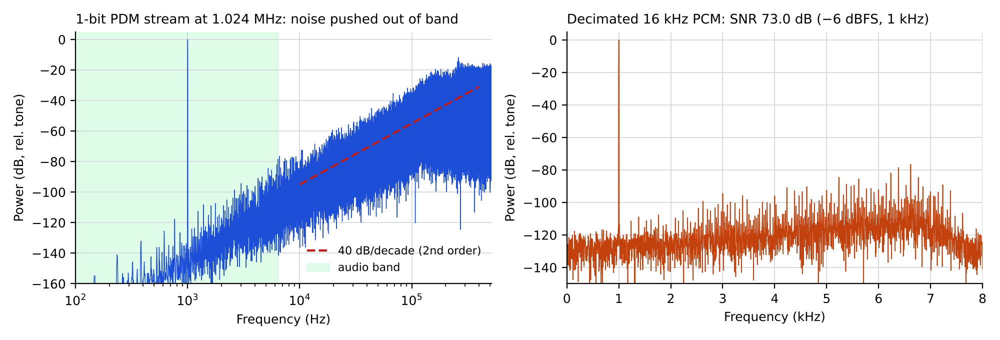
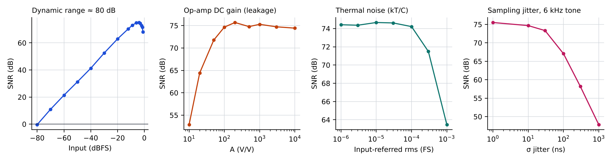

# VoxCore: a push-to-talk voice-recognition SoC

VoxCore is a RISC-V SoC with dedicated hardware for on-device speech
recognition. You press a button and speak a digit. The chip captures the audio
from a PDM (sigma-delta) microphone or over I2S, extracts MFCC speech features in a hardware DSP pipeline, classifies
them with an int8 neural-network accelerator, and the RISC-V core reports the
result over UART and GPIO.

The CPU is **vc_rv32i**, a 5-stage pipelined RV32I core with dynamic branch
prediction (BTB + 2-bit counters + return-address stack), written from scratch.
It is extended with **VC.MAC**, a custom RISC-V instruction-set extension
(int8 dot-product and multiply-accumulate) attached through a PCPI
co-processor port. PicoRV32 can be selected instead (`CPU_SEL=1`) as a
reference.

The audio front-end is **mixed-signal**: the analog half of a sigma-delta ADC
(a 2nd-order modulator with op-amp gain, thermal noise and comparator offset)
is modelled in SystemVerilog real-number modelling (RNM), and the digital half
(PDM clock generation, CIC + FIR decimation) is synthesizable RTL.

Everything is written in SystemVerilog and verified **bit-exact** against
Python reference models: the DSP and NN against a golden model, the PDM
decimator (with the analog model in the loop) against Python, and the core
instruction-by-instruction against an ISS.

```
 MEMS mic / codec                         VoxCore
 ───────────────     ┌─────────────────────────────────────────────────────────┐
  I2S SCK/WS/SD ───▶ │ i2s_rx ─┐                                               │
                     │ (2FF CDC)├▶ mfcc_engine ─▶ feature RAM ─▶ nn_engine      │
 PDM mic (analog ΣΔ) │         │   window·FFT·mel  490×int8      8-lane MAC     │
  pdm_clk ◀──────────│ pdm_rx ─┘   log2·DCT·norm                 argmax         │
  pdm_dat ──────────▶│ CIC4÷32 · FIR95÷2 → 16 kHz PCM                            │
                     │        └──────────── voice_apb (regs) ───────────┘       │
                     │                         │ APB                           │
                     │  vc_rv32i ── apb_bridge ┼── uart_apb ──▶ UART TX         │
                     │  5-stage  │   16 KB     └── gpio_apb ◀─▶ button / LEDs   │
                     │  RV32I    │   dual-port SRAM (I-port + D-port)           │
                     │     │PCPI                                               │
                     │  VC.MAC  (vc.mac / vc.dot4 custom-0 instructions)       │
                     └─────────────────────────────────────────────────────────┘
```

**Datasheet:** [`docs/VoxCore_VC1_Datasheet.docx`](docs/VoxCore_VC1_Datasheet.docx): features, pinout, memory map, registers, ISA extension, performance and verification summary.

## Results

| Metric | Value |
|---|---|
| Task | Spoken digits 0–9 (Free Spoken Digit Dataset, 3,000 clips) |
| Accuracy, float model | 96.0 % (test set) |
| Accuracy, int8 hardware model | 96.3 % (test set) |
| RTL vs golden model | Bit-exact: 490/490 features and 16/16 logits on all 10 test clips |
| End-to-end SoC sim | 10/10 clips: correct digit on GPIO and UART |
| MFCC compute per frame | about 14k cycles (frame period at 16 kHz and 50 MHz: about 1M cycles) |
| NN inference | 4,903 cycles (49 µs at 100 MHz), 4,560 MACs × 8 lanes |
| Model size | 36.5 KB int8 weights + 144 int32 biases |
| vc_rv32i CPI (software loop) | **1.05** with branch prediction (1.21 without; PicoRV32: 4.61), same 63,269-instruction loop |
| Branch prediction | 99.3 % accuracy over a full firmware run (4,722 mispredicts in 722,583 control-flow instructions); 13 % fewer cycles on the software dot product |
| vc.dot4 speed-up, 512-element int8 dot product | **47×** on vc_rv32i (66,605 → 1,417 cycles); 59× on PicoRV32 |
| vc.mac speed-up, 64-element int32 MAC | **16×** on vc_rv32i; 20× on PicoRV32 |
| Own core + VC.MAC vs PicoRV32 software | **206×** fewer cycles on the int8 dot product |
| CPU verification | 37/37 rv32ui ISA tests (also under 50 % random bus stalls), 300/300 random programs matching the ISS, branch-predictor performance test |
| PDM / sigma-delta path | **74.3 dB SNR, 12.1 ENOB** at −6 dBFS (4-tone average; 73–76 dB per tone, 76.3 dB on the RTL test tone); ≈ 80 dB dynamic range; decimator adds < 0.1 dB |
| Accuracy through the PDM path | 95.3 % (test set, analog model → decimator → MFCC → NN) vs 96.3 % from clean PCM |
| Generic synthesis (Yosys) | about 103k gates excluding memories: MFCC 59k, NN 20k, vc_rv32i 12.8k (8.5k without the predictor), VC.MAC 6.0k, PDM decimator 4.8k (PicoRV32 is 7.3k) |

Note that FSDD's test split shares speakers with the training set, so 96 % is
speaker-dependent accuracy. Retraining on Google Speech Commands (below) gives a
speaker-independent number.

## Repository layout

```
model/   voxcore_model.py  bit-accurate golden model (every RTL block mirrored)
         train.py          trains + quantises the NN, exports ROMs and test vectors
         pdm_model.py      sigma-delta modulator model, bit-exact CIC/FIR decimator, FIR design
         pdm_analysis.py   SNR/ENOB, noise-shaping spectrum, non-ideality sweeps (-> docs/)
         pdm_export.py     PDM-path golden vectors + accuracy through the PDM path
data/    *.hex             ROM contents (window, twiddles, mel, DCT, norm, weights, biases)
         nn_cfg.svh        auto-generated NN constants included by nn_engine.sv
         vectors/          per-clip PCM / features / logits + expected classes
rtl/     mfcc_engine.sv    DSP front-end
         nn_engine.sv      NN accelerator
         voice_apb.sv      voice subsystem + register map
         voxcore_top.sv    SoC top (memory map, CPU_SEL)
         cpu/vc_rv32i.sv   own 5-stage pipelined RV32I core
         cpu/vc_mac_pcpi.sv VC.MAC custom ISA extension (PCPI co-processor)
         periph/           i2s_rx, pdm_rx (PDM clock + CIC/FIR decimator), uart_apb, gpio_apb,
                           aes128_enc, aes_apb (AES-128 encryption peripheral)
         ams/sdm_rnm.sv    analog sigma-delta modulator, real-number model (testbench / AMS view)
         soc/apb_bridge.sv PicoRV32 native bus -> APB3 master + decoder
         mem/              SRAM/ROM wrappers (behavioral; black boxes for synthesis)
         third_party/      PicoRV32 (ISC licence), reference CPU
tb/      tb_mfcc.sv tb_nn.sv  DSP / NN block tests
         tb_mac.sv            VC.MAC constrained-random test + coverage
         tb_core.sv           CPU harness (either core, random bus wait states, trace dump)
         tb_pdm.sv            mixed-signal: analog RNM + PDM decimator, bit-exact + SNR
         tb_soc.sv            full-chip test (either core, I2S or PDM microphone)
verif/   isa/              37 rv32ui ISA tests (riscv-tests, BSD) + runner
         rand/gen.py       constrained-random program generator
         rand/iss.py       RV32I + VC.MAC instruction-set simulator (reference)
         perf/bpred.S      branch-predictor performance test (misprediction budget)
fw/      start.S main.c link.ld Makefile  bare-metal RISC-V firmware
         vc_mac.h          intrinsics for the custom instructions
sim/     Makefile           Verilator flow + regression logs
docs/    VoxCore_VC1_Datasheet.docx      product datasheet (make_datasheet.js + make_figures.py regenerate it)
syn/     dc/run_dc.tcl dc/voxcore.sdc     Design Compiler on ASAP7
         yosys_check.sh                    open-source synthesizability check
```

## How to run

Requirements: Python 3 with numpy, scipy and scikit-learn; Verilator 5.x;
riscv64-unknown-elf-gcc. Optional: sv2v + Yosys, and Synopsys DC.

```bash
# 1. (optional) retrain + regenerate all ROMs and vectors
git clone https://github.com/Jakobovski/free-spoken-digit-dataset
python3 model/train.py free-spoken-digit-dataset/recordings
#    or, speaker-independent, 10 command words:
python3 model/train.py /path/to/speech_commands_v0.02 --speech-commands

# 2. simulate
cd sim
make regress        # everything below, both CPUs (~2 min)
make isa            # rv32ui ISA tests on vc_rv32i (+50% stalls) and PicoRV32
make rand           # 300 random programs, vc_rv32i vs ISS
make mac            # VC.MAC unit, 20k random ops
make pdm            # analog sigma-delta model + PDM decimator, bit-exact + RTL SNR
make soc_pdm CLIP=7 # full chip with the PDM microphone path
make soc CLIP=7     # one end-to-end run on vc_rv32i, prints the UART console
make soc_pico CLIP=7  # same on PicoRV32

# 3. mixed-signal characterisation (plots + numbers into docs/)
python3 model/pdm_analysis.py
cd sim && make pdm_nonideal A=20   # RTL sim with a finite-gain op-amp in the analog model

# 4. synthesize
cd ../syn/dc && dc_shell -f run_dc.tcl     # edit ASAP7_DB_DIR first; CPU_SEL picks the core
```

Expected `make soc CLIP=7` output:

```
[uart] dot512 sw=147228 cyc=66605 | hw=147228 cyc=1417 | speedup x47
[uart] mac64  sw=1945479539 cyc=11412 | hw=1945479539 cyc=712 | speedup x16
[uart] cpi x100=105 (sw dot loop, 63269 instr)
[uart] MACTEST PASS
[uart] VoxCore ready
[tb] streaming clip7 over I2S
[uart] listening (I2S)
[uart] DIGIT=7 score=0x00003673
  [vc_rv32i] branch predictor  on: 722583 control-flow instrs, 4722 mispredicted
==== tb_soc[vc_rv32i] clip7 PASSED (digit 7, 42.5 ms sim time) ====
```

## Design notes (why each choice was made)

### Signal chain and fixed-point formats

| Stage | Operation | Format |
|---|---|---|
| Input | 16 kHz PCM, 1 s utterance | int16 |
| Framing | 49 frames × 512 samples, hop 320 (32 ms / 20 ms) | 1024-entry ring buffer |
| Window | Hamming, `xw = (x·w) >>> 15` | w: unsigned Q1.15 |
| FFT | 512-pt radix-2 DIT, in place, bit-reversed load | 28-bit data, Q1.15 twiddles |
| Power | `P = (Xr² + Xi²) >> 16`, bins 0..256 | 41-bit unsigned |
| Mel | 32 triangular filters, 60–7800 Hz | 9-bit weights, 50-bit accumulators |
| Log | `log2 ≈ msb + 10 mantissa bits` (piecewise linear) | U6.10 |
| DCT | 10 coefficients | Q2.14 cosines, 40-bit accumulator |
| Normalize | `sat8((c − off) >>> sh)`, per coefficient | int8 feature |
| NN | 490 → 64 → 64 → 16, ReLU + power-of-two requant | int8 weights, int32 accumulators |

### Key decisions to be ready to explain in interviews

- **Why a golden model first?** Every bit width, shift and rounding mode is
  decided in Python, where it's cheap to sweep and to measure accuracy. The RTL
  then has exactly one correct answer, so the testbenches compare with `!==` and
  any 1-LSB difference is a bug.
- **Why no per-stage FFT scaling?** Scaling by ½ every stage throws away 9 bits.
  Quiet speech then falls into the noise floor. Growing the datapath to 28 bits
  (16 + 9 + margin) is cheaper than block floating point and needs no exponent
  tracking. The Python model asserts no overflow on all 3,000 clips.
- **Why a sequential, time-multiplexed datapath?** One audio frame arrives
  every 20 ms, which is about 1M cycles at 50 MHz, and the MFCC engine needs
  about 14k. Fully pipelining would waste area for no throughput benefit. The
  right trade for always-available audio is minimum area and power.
- **Why the mel trick (each bin feeds 2 filters)?** Triangular filters overlap
  by exactly half. Storing one filter index and one 9-bit weight per bin
  replaces a 32 × 257 matrix multiply with 257 × 2 MACs and a 257-entry ROM.
- **Why log2 instead of ln?** In hardware the integer part of log2 is just a
  leading-one detector, and the mantissa bits give a linear interpolation (max
  error about 0.086 in log2). Base and scale are absorbed by normalization and
  the NN.
- **Why output-stationary 8-lane MAC?** One input activation is broadcast to
  8 lanes, and each lane has its own weight byte in one 64-bit word. The
  accumulators never leave the array until the neuron is finished, so there is
  no partial-sum traffic. The read pipeline is overlapped, giving 1 MAC per lane
  per cycle.
- **Why power-of-two requantization?** Multiplying by an arbitrary scale costs
  a 32-bit multiplier per lane. A shift is free, and it cost no accuracy here
  (int8 test accuracy 96.3 % vs 96.0 % float).
- **CDC:** I2S SCK/WS/SD are asynchronous to the system clock. Each is
  synchronized with 2 flops, and the receiver works on detected SCK edges
  (requires f_clk ≥ 4·f_sck). The ring buffer is 2× the frame length, so a frame
  can be read while new samples keep arriving. An overflow flag catches a
  processing backlog.
- **Memories as macros:** all RAM/ROM sits behind `vc_*` wrappers with an SRAM
  port list. They are behavioral in simulation and black boxes in synthesis
  (`VOXCORE_BLACKBOX_MEM`), so the netlist can be dropped onto memory-compiler
  macros.

### VC.MAC custom instruction-set extension

R-type, opcode **custom-0** (`0001011`), funct7 = `0000000`. Each instruction
returns the new accumulator value in `rd`.

| funct3 | Mnemonic | Operation |
|---|---|---|
| 000 | `vc.mac rd, rs1, rs2` | acc += rs1 × rs2 (signed, low 32 bits) |
| 001 | `vc.mul` | acc = rs1 × rs2 |
| 010 | `vc.dot4` | acc += Σ int8(rs1.byte[i]) × int8(rs2.byte[i]), i = 0..3 |
| 011 | `vc.dot4z` | acc = Σ int8 dot (starts a new sum) |
| 100 | `vc.setacc` | acc = rs1 |
| 101 | `vc.rdacc` | (acc unchanged) |
| 11x | reserved | not claimed, so the CPU traps (illegal instruction) |

In C (`fw/vc_mac.h`): `vc_setacc(0); for (...) s = vc_dot4(a4[i], b4[i]);`.
The assembler emits them with `.insn r 0x0b, <funct3>, 0, rd, rs1, rs2`, so no
compiler changes are needed.

Design decisions:

- **Why a hidden accumulator?** The PCPI port (like any 2-read-port register
  file) delivers only rs1 and rs2, never the old rd. Keeping the sum in the
  unit saves an `add` per iteration. The trade-off is extra architectural state
  an OS would have to save on a context switch, which is fine for bare metal.
  ARM's SDOT avoids this by reading rd as a third source, at the cost of a
  third register-file read port.
- **Why the PCPI port?** It's the same co-processor interface on both CPUs, so
  one verified unit plugs into PicoRV32 and vc_rv32i unchanged. PicoRV32 holds
  `pcpi_valid` until `pcpi_ready`, so the unit starts only on
  `valid && !ready`. The `pcpi_wait` signal stops PicoRV32's 16-cycle
  illegal-instruction timeout.
- **Why it's 47×, not 4×:** RV32I has no multiply, so each `a[i]*b[i]` is a
  `__mulsi3` shift-and-add call. The measured software loop runs about 124
  instructions per element (63,269 for 512). `vc.dot4` does 4 multiplies, 3 adds
  and the accumulation in one instruction. The compiled loop is 7 instructions
  per 4 elements (2 address adds, 2 loads, `vc.dot4`, increment, branch).

### vc_rv32i microarchitecture

```
        ┌────┐  IF/ID = SRAM   ┌────┐  ID/EX  ┌────┐  EX/MEM  ┌─────┐  MEM/WB  ┌────┐
 PC ──▶ │ IF │  output reg ──▶ │ ID │ ──────▶ │ EX │ ───────▶ │ MEM │ ───────▶ │ WB │
        └────┘                 └────┘         └────┘          └─────┘          └────┘
   BTB/RAS ─┤ predicted next PC (0 penalty when right)          │  ▲ D-bus valid/ready
          ▲  redirect on mispredict (1 squashed instr)          │  │ (stall whole pipe)
          └────────────────────────────────────────────────────┘  │
                       forwarding: EX/MEM → EX, MEM/WB → EX, WB → ID (write-through)
                       load-use: 1 bubble   ·   PCPI ops stall EX until ready
```

| Item | Choice | Why |
|---|---|---|
| Fetch | The synchronous I-SRAM's output register *is* the IF/ID register. Stall = SRAM enable low (output holds). | Saves a 32-bit pipeline register and keeps fetch single-cycle with real SRAM timing |
| Buses | Harvard: I-port fixed 1-cycle latency, D-port valid/ready (same as PicoRV32's bus) | No structural hazard; peripherals with wait states (APB) just stall MEM |
| Branch prediction | 16-entry direct-mapped BTB (tag, target, type, 2-bit counter), indexed by the PC of the instruction in ID, so the next fetch address is predicted without decoding. Conditional direction comes from the 2-bit saturating counter; jumps are always taken; returns (`jalr x0, 0(x1/x5)`) use a 4-entry return-address stack. Prediction is checked in EX (direction and target); a mispredict squashes 1 instruction. `BP_EN=0` gives static not-taken. | Lookup uses a register (id_pc), not SRAM data, so the predictor stays off the SRAM-out → SRAM-address path. The RAS is updated when the call/return leaves ID, which only happens on the correct path, so it never needs repair. CPI 1.21 → 1.05. |
| Allocation | BTB entry allocated on the first *taken* execution (counter = weakly taken); never-taken branches never occupy an entry. An entry that predicts on a non-branch is invalidated. | Saves BTB capacity for branches that matter |
| Precise halt | `trap` rises only after older instructions have retired | Found by random testing: a load still waiting on a stalled bus was being dropped |
| Hazards | Full forwarding, 1-cycle load-use bubble, WB→ID write-through | Classic textbook 5-stage design (Hennessy & Patterson), on RISC-V |
| Held operands | While EX is stalled it re-latches its forwarded operands every cycle | The producer can retire out of the forwarding window during a stall. Random testing proved this is needed: removing it fails 30/30 random programs and 3 ISA tests under bus stalls |
| CSRs | `cycle`, `instret` (Zicntr), `hpmcounter3` (control-flow instructions), `hpmcounter4` (mispredicts); read-only | Needed for the benchmarks and the predictor perf test |
| Traps | ECALL / EBREAK / illegal → halt with `trap` | Bare-metal; no exception handler yet |
| Trace port | RVFI-style retirement trace (pc, insn, rd, wdata) from WB | Lockstep comparison against the ISS |

### Mixed-signal audio front-end (PDM / sigma-delta)

**Is it analog?** A sigma-delta ADC has two halves:

| Half | Circuit | In VoxCore |
|---|---|---|
| Analog | 2 switched-capacitor integrators (op-amps), a comparator and a 1-bit feedback DAC. Turns the microphone voltage into a 1-bit stream at 1.024 MHz whose *density of 1s* follows the signal, with quantisation noise pushed to high frequencies (noise shaping). | `rtl/ams/sdm_rnm.sv`: behavioural real-number model (SystemVerilog `real`). It sits inside a PDM MEMS mic, or on-chip as an analog macro. |
| Digital | Decimation filter: low-pass, then reduce the rate 64× to 16 kHz 16-bit PCM | `rtl/periph/pdm_rx.sv`: synthesizable RTL |

```
 analog (RNM)                                   digital RTL (pdm_rx)
 u ─►(+)─► ∫ ─►(+)─► ∫ ─► comparator ─┬─► pdm_dat ─► 2FF ─► CIC4 ÷32 ─► FIR95 ÷2 ─► PCM 16 kHz
      ▲−        ▲−                   │              (1.024 MHz)  (32 kHz)
      └─────────┴──── 1-bit DAC ◄────┘     pdm_clk ◄── clock divider (f_clk / PDM_DIV)
```



| Parameter | Value |
|---|---|
| Modulator | 2nd-order discrete-time, Boser-Wooley (integrator gains ½), 1-bit, OSR 64 |
| PDM clock | 1.024 MHz = f_clk / PDM_DIV (generated by the chip; data sampled before the rising edge) |
| CIC | 4th order, ÷32, 24-bit modular arithmetic (21 bits needed), integrators at the bit rate |
| FIR | 95 taps, least-squares, **CIC droop compensation**, passband 0–6.4 kHz (0.015 dB ripple), stopband ≥ 8 kHz (≥ 79 dB), Q1.15 coefficients, 1 MAC/cycle |
| SNR / ENOB | 74.3 dB / 12.1 bits at −6 dBFS (average of 4 tones; single tones give 73–76 dB because 1-bit 2nd-order loops have idle tones; the RTL test tone measures 76.3 dB / 12.4 bits); peak ≈ 75 dB near −4 dBFS; dynamic range ≈ 80 dB |
| Overload | SNR falls above about −3 dBFS (the 2nd-order loop starts to saturate) |

**Analog non-idealities** (averaged over 4 tones; `model/pdm_analysis.py`):



- **Op-amp DC gain:** SNR is flat for A ≥ 100 and collapses below A ≈ 50 (A = 10 gives 53 dB). This is the textbook rule that the op-amp gain should exceed the oversampling ratio (64). It is confirmed in RTL simulation: `-GOPAMP_GAIN=20.0` measures 61 dB on the RTL output.
- **Thermal (kT/C) noise:** no loss up to about 1e-4 FS rms, then −3 dB at 3e-4. That sets the sampling-capacitor size.
- **Comparator offset:** no effect up to 0.4 FS. The 1-bit quantiser sits inside the loop, so its offset is shaped away. (That's why sigma-delta comparators can be tiny.)
- **Clock jitter:** at 6 kHz input, σ ≤ 30 ns costs < 2 dB; 100 ns costs 8 dB.

Design decisions:

- **Why CIC + FIR?** The CIC does the heavy ÷32 with no multipliers (only
  adders), where the rate is highest. The FIR then runs at only 32 kHz, so
  one shared multiplier does 95 taps per output. It also fixes the CIC's
  passband droop.
- **Why 2 stages (÷32, ÷2) instead of ÷16, ÷4?** At 32 kHz the 6.4→8 kHz
  transition is twice as wide relative to the sample rate. The 95-tap FIR
  then reaches 79 dB, whereas a 160-tap FIR at 64 kHz only reached 65 dB.
- **Why a real-number model?** RNM runs at digital-simulation speed (1M PDM
  bits per second of simulation), and with ideal parameters it produces the
  *identical* bitstream to the Python model. So the digital decimator is
  checked bit-exact with an "analog" block in the loop. A transistor-level
  modulator (Virtuoso) can replace it in AMS co-simulation using the same
  ports.
- **Restart alignment:** writing `CTRL.MFCC_START` with `SRC_PDM` starts
  `pdm_clk` and clears the filters in the same cycle the MFCC capture
  starts, so sample 0 of the utterance is decimator output 0.

### Register map (voice subsystem, base 0x1000_2000)

| Offset | Name | Access | Description |
|---|---|---|---|
| 0x000 | CTRL | W / RW | bit0 MFCC_START, bit1 NN_START (pulses); bit2 AUTO_NN; bit3 SRC_PDM (0 = I2S, 1 = PDM) |
| 0x004 | STATUS | R | bit0 mfcc_busy, bit1 mfcc_done, bit2 nn_busy, bit3 nn_done, bit4 overflow, [13:8] frames |
| 0x008 | RESULT | R | [3:0] class |
| 0x00C | PDM_DIV | RW | [7:0] f_clk / f_pdm, ≥ 8 (reset 49) |
| 0x040–0x07C | LOGIT[16] | R | int32 scores |
| 0x800–0xFA4 | FEATURE[490] | R | int8 (sign-extended), 1 APB wait state |

UART is at 0x1000_0000 (TXDATA, STATUS, DIV) and GPIO at 0x1000_1000 (IN, OUT).

### AES-128 encryption peripheral (base 0x1000_3000)

`rtl/periph/aes128_enc.sv` is an AES-128 encryption core written from FIPS-197: one round per
clock, round keys expanded on the fly, 11 clocks from START to result. `rtl/periph/aes_apb.sv`
wraps it in an APB slave and sits in the fourth APB slot of the SoC. Generic Yosys synthesis of
the peripheral alone: about 15.7k gates, 519 flip-flops.

| Offset | Name | Access | Function |
|---|---|---|---|
| 0x00 | CTRL | W | [0] START one block (ignored while busy), [1] CLEAR: wipe key, plaintext, ciphertext and core state |
| 0x04 | STATUS | R | [0] BUSY, [1] DONE, [2] WERR: a write was dropped because the core was busy (write 1 to clear) |
| 0x10-0x1C | KEY0..3 | W | key, KEY0 = bits 127:96. Write-only: reads return 0 |
| 0x20-0x2C | PT0..3 | RW | plaintext |
| 0x30-0x3C | CT0..3 | R | ciphertext. Reads 0 unless DONE is set |

Security rules built into the register map, each one tested:

- the key can never be read back over the bus;
- the round state is never visible (CT reads 0 while BUSY);
- KEY and PT cannot change under a running block (the write is dropped and WERR is set);
- CLEAR wipes all key and data registers in one write, and aborts a running block;
- the core's round-key register is wiped when the last round finishes.

Verification, two layers:

1. `make aes` (`tb/tb_aes.sv`, Verilator or Icarus): the 7 FIPS-197 / NIST SP 800-38A known
   answers, then 1000 corner and random blocks, bit-exact against `model/aes_model.py`, plus
   directed tests of every security rule, CLEAR and reset in each of the 10 rounds, and
   coverage counters that fail the run if a scenario was missed. `make aes_mut` rebuilds with
   two injected bugs (wrong round constant, MixColumns in the last round) and checks that the
   testbench fails on both.
2. `verif/aes_uvm/`: a UVM environment. An APB agent (sequencer, driver, monitor), a scoreboard
   with a register model of the block and a C reference model through DPI, covergroups with
   crosses, SVA assertions attached with `bind`, and tests for known answers, random blocks with
   attacks inside the busy window, a register sweep for coverage closure, and unstructured bus
   fuzzing. `run_xsim.ps1` runs it on the Vivado simulator (results below); `run_vcs.sh` is the
   same flow for Synopsys VCS and has not been run yet.

UVM regression on Vivado xsim 2025.2, `aes_full_test`, seeds 1 to 5: all pass. Per seed, about
19,000 reads checked by the scoreboard with 0 mismatches, about 1,650 blocks encrypted, 10
assertions with 0 failures, and 100% functional coverage on all three covergroups (bus, control,
block). The two injected bugs both fail the UVM known-answer test.

A bug the UVM fuzz test found: the first version of `aes_apb` decoded only address bits 7:2, so
every register, including the ciphertext and the key write port, was also reachable at 15 alias
addresses higher up in the 4 KB slot. The directed testbench only checked unmapped offsets up to
0xFC and missed it. The scoreboard reported a read mismatch at offset 0x338; the decode now
requires address bits 11:8 to be zero, and the directed testbench sweeps the whole slot.

Not covered: decryption, 192/256-bit keys, block-cipher modes (the firmware would chain blocks),
and side-channel resistance (the S-box is a plain lookup, timing is constant at 11 clocks but
power is not masked). The firmware does not use the peripheral yet.

## Verification

| Test | What it checks | Status |
|---|---|---|
| `tb_mfcc` | 10 clips, all 490 features bit-exact, no overflow | PASS |
| `tb_nn` | 10 clips, all 16 logits + class bit-exact, cycle count | PASS |
| `tb_pdm` | Analog sigma-delta RNM + PDM decimator: 1 kHz sine (4,096 samples) and 3 speech clips (16,000 samples each), every output sample bit-exact vs Python; SNR measured on the RTL output | PASS (76.3 dB) |
| `tb_mac` | 20,000 constrained-random VC.MAC ops (corner-biased operands, random gaps, back-to-back issue, illegal encodings must not be claimed), reference model, coverage goals per opcode | PASS |
| ISA tests | 37 rv32ui tests on vc_rv32i (0 % and 50 % random D-bus wait states) and PicoRV32 | 111/111 PASS |
| Random lockstep | 300 generated programs × 500 items (forwarding chains, load-use, store→load, branches/JAL/JALR, loops, calls/returns, nested calls, indirect jumps with changing targets, recursion deeper than the RAS, back-to-back custom ops), 0/25/50 % bus stalls; every retired instruction (pc, insn, rd, value) compared with the Python ISS | 300/300 PASS |
| Predictor perf test | Directed loop (call/return, always/never-taken, alternating branch, back-edge) must stay under a misprediction budget. Catches bugs that are *functionally* invisible because EX corrects every mispredict (e.g. a wrong RAS push address). | PASS (204 mispredicts, budget 210; 899 with prediction off) |
| `tb_soc` × 10 × 3 | Boot, MAC self-test, button, audio in (I2S on both CPUs, and PDM through the analog model on vc_rv32i), MFCC, auto NN start, firmware, UART + GPIO result, plus features and logits checked via hierarchical reference | 30/30 PASS |
| Mutation checks | Breaking the MFCC power shift, the NN requant shift, the PDM CIC output shift, the VC.MAC int8 sign extension, the core's WB forwarding, its EX-hold operand latch, the mispredict target check or the RAS push address each makes a test fail (the tests aren't vacuous). The target-check mutant first *passed* everything, which exposed a coverage hole (no predicted-taken-wrong-target case). The indirect-jump and deep-recursion stimulus was added to close it. | done |
| Lint | `make lint`: Verilator `-Wall` shows only width-extension / unused-bit style warnings | done |

## Limitations and next steps

These are honest gaps, and each one is a good next milestone:

1. **UVM environment.** The current testbenches are directed and self-checking
   in SystemVerilog. Next: UVM agents for APB and I2S, a scoreboard calling the
   Python model through DPI-C, constrained-random back-pressure, and
   functional coverage (run on Questa/Xcelium at ASU).
2. **SVA protocol checkers** for APB (stable `paddr`/`pwrite` during ACCESS,
   `penable` only after SETUP) and I2S framing.
3. **Interrupts and exceptions** in vc_rv32i: `mtvec`/`mepc`/`mcause`, a
   `done` interrupt from the voice block instead of polling, and
   misaligned-access traps.
4. **Core performance:** a gshare/tournament direction predictor (the
   alternating-branch case defeats 2-bit counters), storing BTB targets as
   14-bit word addresses (BTB entry 47 → 29 bits), and the M extension
   as a multi-cycle unit on the same PCPI port.
5. **riscv-formal / RVFI:** the trace port already looks like RVFI, so the
   next step is connecting it to riscv-formal for formal ISA checks.
6. **Mixed-signal next steps:** a transistor-level modulator in Cadence
   Virtuoso (comparator + switched-cap integrators) co-simulated with
   `pdm_rx` in AMS Designer; a 3rd/4th-order or multi-bit modulator for more
   SNR; and DC-blocking / gain control after the decimator.
7. **Low power:** UPF power domain around MFCC + NN (off while idle).
   Clock gating is already enabled in the DC script.
8. **Area optimization:** share the FFT multipliers with the power-spectrum
   squarers, and move the mel accumulators into a small RAM (about 1,600 flops
   today).
9. **Speaker-independent accuracy:** retrain on Google Speech Commands
   (`--speech-commands`).
10. **Real SRAM macros:** generate ASAP7 fakeram views and link them in DC.

## Credits

- PicoRV32 RISC-V core by Claire Xenia Wolf / YosysHQ (ISC licence, see
  `rtl/third_party/picorv32/COPYING`), used as the reference CPU.
- rv32ui ISA tests from riscv-tests (UC Berkeley, BSD licence, see
  `verif/isa/tests/LICENSE`), as adapted in the PicoRV32 repository.
- Free Spoken Digit Dataset by Zohar Jackson et al. (CC BY-SA 4.0).
